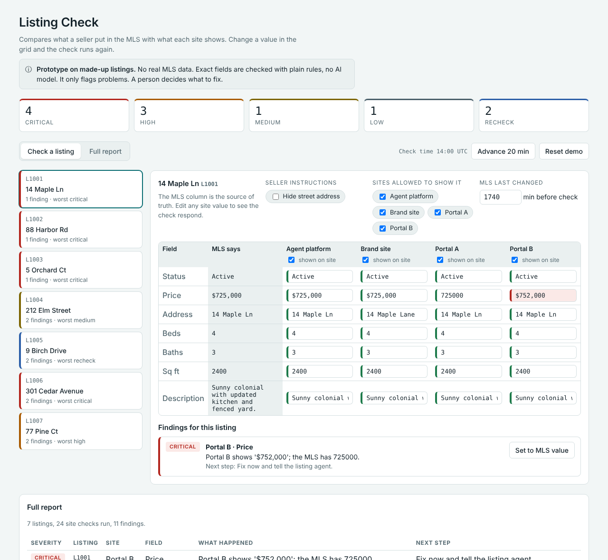
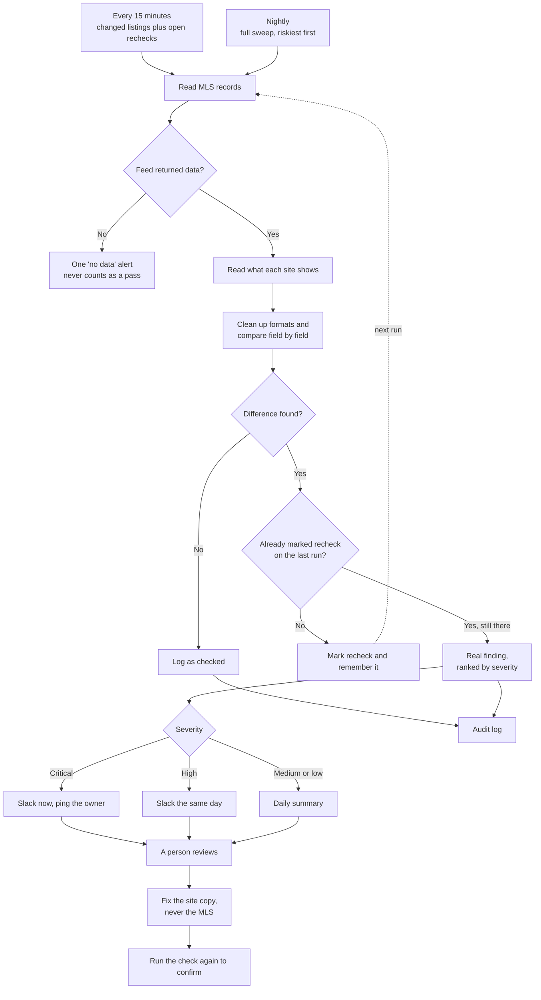

# Listing validation prototype

When a listing moves from the listing agent to the MLS and out to other sites, details can change or go missing along the way. This prototype shows one way to catch that automatically. It treats the MLS entry as the source of truth, compares what each site shows, ranks the differences by business impact, and sends them to a person to review.



A small prototype that checks whether a listing shows the right information on each site, using the MLS record as the source of truth.

**This is a prototype on made-up data.** The listings, addresses and site displays are invented. It does not use real MLS data and it is not a production system.

## What it does
- Reads an MLS-style record for each listing.
- Reads what each site shows (agent platform, brand site, two portals).
- Compares status, price, address, beds, baths, square footage and description.
- Ignores formatting differences ("$725,000" vs "725000", "Lane" vs "Ln", "For Sale" vs "Active").
- Checks the seller's instructions: hidden address, and which sites may show the listing.
- Ranks each mismatch by business impact (critical, high, medium, low).
- Marks a mismatch as "recheck" if the MLS changed in the last 15 minutes, since a site may not have synced yet.
- Writes a report, a CSV of findings, and an audit log of what was checked.

It only flags. It never changes a listing. A person reviews the exceptions.

## Demo page
`docs/index.html` is a single-page version of the same checks that runs in a browser. Open it in any browser, pick a listing, and edit a site value to watch the check respond. No server or install needed.

## Run it
```
python3 listing_validator.py
python3 test_validator.py
```
Output goes to `output/` (report.md, findings.csv, audit_log.jsonl). A saved example is in `sample_output/`.

## How it handles bad input
- A missing or unreadable value in the MLS record is flagged once and skipped. The rest of that listing is still checked.
- A missing or unreadable value on a site is flagged. It does not crash the run.
- One broken record is recorded as an error and the run continues. Nothing is dropped silently.
- 12 tests cover price formats, status synonyms, hidden address leaks, syndication rules, missing listings, sync lag, truncated text and bad records.

## Why plain rules and not an LLM
Exact fields like price and status are checked with rules, so the result is the same every time and easy to audit. An LLM is a better fit for the fuzzy parts, such as mapping an unfamiliar field name, comparing description text, or explaining a mismatch in plain language. This version does not call an LLM.

## What it does not do yet
- Pull from a real feed. The next step would be reading the MLS record through the RESO Web API, after Legal confirms the data licensing terms.
- Read live pages or site APIs. Today the site displays are a file.
- Check photos, open houses or fields that differ by MLS rule set.
- Run on a schedule, send alerts, or track error rates and hours saved.
- Check description text for Fair Housing issues. That needs Legal and Compliance involved first.

## Seeded problems in the sample data
| Listing | Problem | Expected result |
|---|---|---|
| L1001 | Price shown as $752,000 on portal_b | Critical |
| L1002 | Brand site says For Sale, MLS says Pending | Critical |
| L1003 | Hidden address shows on portal_a | Critical |
| L1004 | Square footage 1580 vs 1850; cut-off description | Medium, low |
| L1005 | Price changed 8 minutes before the check | Recheck |
| L1006 | Missing from brand site; shown on a site the seller did not allow | High, critical |
| L1007 | Bad values in the MLS record itself | High, run continues |

## Roadmap: alerts and self-healing (plan, not built)
This version has no Slack alert and makes no fixes. The plan:
1. **Alert.** Critical findings post to Slack (or a similar place) right away with the listing, site, field, what the MLS says, what the site shows, and a suggested next step. High findings post the same day. Medium and low go in a daily summary. A sync-delay recheck stays quiet unless it still fails.
2. **Suggest a fix.** The tool proposes the exact correction and a person approves it.
3. **Auto-fix low risk.** Only a short approved list, such as re-sending the MLS data to a site, with a re-check after every fix, a rollback, a kill switch and an audit trail.
4. **Widen slowly,** only after weeks of accurate suggestions.

**Which way fixes go:** the MLS entry made by the listing agent is the source of truth. The tool corrects the site copies to match it. It does not edit the MLS record. If the MLS entry looks wrong, it alerts the listing agent or data owner. Any write access needs Legal and MLS approval first.

## Toward an agentic workflow (idea, not built)
Today this is a rules-based validation workflow. It is not an agent, because no AI model decides what to do next. These are the steps I would take to grow it into one, in order. Exact fields such as price and status would stay rule-based so the results remain auditable.

1. **Add an AI step for the judgment calls.** Compare description text to the MLS remarks and explain a mismatch in plain language. Build a small labeled test set first (pairs with known answers) and measure accuracy before relying on it.
2. **Let it investigate, read-only.** Give it tools to fetch the MLS record, fetch a site page, and read earlier runs. Before alerting, it gathers evidence: is the difference still there, does it affect other listings or sites, did it start after a particular change. It reports a root-cause guess, for example "Portal B looks like it is serving a cached copy."
3. **Let it propose actions.** It drafts the alert and the suggested fix and names which tool would apply it. A person approves.
4. **Give it memory.** Keep past findings and the ones marked "not an issue," so it triages better over time.
5. **Add guardrails before any write access.** A list of allowed tools, a step limit, a log of every tool call, tests on labeled cases, human approval for any change, and a kill switch.
6. **Only then allow limited actions,** starting with the low-risk fixes in the roadmap above.

## When it runs (plan, not built)



The prototype covers the compare, rank and report steps. The schedule, the "recheck" memory between runs, Slack alerts and fixes are the plan.

Two jobs, each with a different purpose.

**Every 15 minutes: catch caching and sync problems.**
- Check listings that changed recently, plus anything still marked "recheck" from the last run. Do not recheck the whole inventory.
- A difference seen for the first time is marked "recheck" and remembered. If the next run still sees it, it becomes a real finding. This is how a cache problem that lasts shows up, without alerting on a normal short delay.
- Check critical fields (price, status, hidden address) on every run. Lower-risk fields such as description text can be checked less often.
- Skip a start if the previous run is still going, so runs never overlap.
- If the feed is down or returns nothing, send one "no data" alert, not one alert per listing.

**Nightly: the safety net.**
- Compare every listing on every site. This catches drift the 15-minute job cannot see, such as a site edited by hand with no MLS change.
- If the full set is too large for one night, sweep it in slices and start with the highest-risk listings.

**Setting the real numbers.** Measure how long each site takes to reflect a change and use that per site. A site whose cache lasts 30 minutes may need two or three runs in a row to fail before alerting. Also check API limits and cost. The prototype uses one fixed 15-minute window for every site and does not yet remember "recheck" results between runs.

## Next steps: connecting real data
This project only works on made-up data today. These steps are the order I would take to point it at real listings. Each step is small enough to test on its own.

**0. Get permission first.** MLS data comes with licensing and use terms. Confirm with Legal and the MLS what you may read, store and show before connecting anything. Keep real listing data, keys and passwords out of this repository. Use environment variables for credentials and add any real data folders to `.gitignore`.

**1. Read the MLS record through a source adapter.** Write one small module that fetches MLS records and returns them in the same shape the validator already uses (`listing_id`, `status`, `list_price`, `address`, `beds`, `baths`, `sqft`, `remarks`, `last_modified`, `hide_address`, `syndicate_to`). The validator stays unchanged. Many MLSs offer the RESO Web API, which returns JSON over HTTPS with an access token and supports filtered queries. RESO's Data Dictionary gives standard field names, so the adapter is mostly a mapping table. Examples:

| This project | RESO field (check the MLS's own docs) |
|---|---|
| `status` | `StandardStatus` |
| `list_price` | `ListPrice` |
| `address` | `UnparsedAddress` |
| `beds` | `BedroomsTotal` |
| `baths` | `BathroomsTotalInteger` |
| `sqft` | `LivingArea` |
| `remarks` | `PublicRemarks` |
| `last_modified` | `ModificationTimestamp` |
| `hide_address` | `InternetAddressDisplayYN` (inverted) |

Field names and status values vary by MLS, so confirm each one against that MLS's documentation.

**2. Read what each site shows through a site adapter.** One adapter per site, each returning the same shape as `site_displays.json`. Use the site's API if it has one. If not, read the public page, following the site's terms and rate limits. Start with one site.

**3. Move the rules into config.** Put each MLS's field mapping, status words, required fields and rules in a config file, not in code, so adding an MLS means adding a file.

**4. Start small and read-only.** One MLS, a handful of listings, one site. Check every finding by hand. Count false alarms and missed problems, then fix the rules.

**5. Run it beside the manual process.** Compare its results to the manual checks for a few weeks and keep a baseline: time spent, problems found, problems missed.

**6. Make an empty result an alert, not a pass.** If the feed returns nothing, times out or returns an error, the run should report "no data" and alert. A broken feed must never look like "all clear."

**7. Schedule it.** Check listings that changed since the last run (using the modification time), plus a full sweep each night. Run it on an internal scheduler or workflow tool, not a public CI log, so real listing data never ends up in public logs.

**8. Add alerts.** Post critical findings to Slack (or similar) with the listing, site, field, what the MLS says, what the site shows, and a suggested next step. Batch medium and low findings into a daily summary. Keep webhook addresses in environment variables.

**9. Protect seller data.** Keep the audit log free of seller personal details, set how long logs are kept, and handle hidden-address listings with extra care in reports and alerts.

**10. Measure, then consider fixes.** Track alerts per day, false alarm rate, time to detect, time to fix and hours returned. Only then consider the suggest-then-approve fix flow from the roadmap above. Fixes always go to the site copies. The MLS record is never edited.
